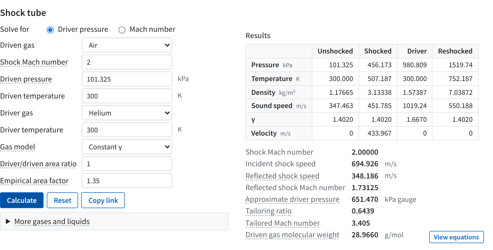

This is the venerable [WiSTL shock tube calculator](https://silver.neep.wisc.edu/~shock/tools/gdcalc.html) with some updates. Credit is due to Jason Oakley & Riccardo Bonazza for the original calculator, which has proved very useful for shock tube work over the years.

Hosted at [https://stillyslalom.github.io/STCalc](https://stillyslalom.github.io/STCalc)



## What it does

- **Shock tube**: incident and reflected shock states and the driver pressure for a desired Mach number, or the Mach number produced by a given driver pressure. A driver-to-driven area ratio at the diaphragm is supported. Reports the tailoring ratio and the tailored Mach number. Unreachable Mach numbers and results outside the constant-γ range produce warnings.
- **Gas models**: constant γ (matches the original calculator) or temperature-dependent specific heats from NASA polynomial fits, with frozen composition, in both the shock tube calculator and the x-t solver.
- **Units**: pressure in Pa, kPa, MPa, bar, atm, psi or Torr and temperature in K, °C or °F, remembered by the browser.
- **More gases, liquids and mixtures**: search about 1000 gases in the NASA CEA database and add them with one click, define your own, mix gases by mole fraction, and model liquids such as water with the stiffened-gas equation of state. Available in every gas list.
- **Shocked interface (RMI)**: exact Riemann solution for the shock crossing an interface into a second gas or liquid, with Richtmyer–Meshkov growth estimates.
- **x-t diagram**: in-browser quasi-1D multicomponent Euler solver (second order, per-slab cross-section) with pressure, density, temperature and velocity maps, probe traces, test-time readouts, and CSV/JSON/HDF5 export. See [XT_DIAGRAM_README.md](XT_DIAGRAM_README.md).
- **Timing** and **boost tank** helpers.
- **Shareable links**: "Copy link to this setup" encodes the shock tube inputs, including custom gases, in the URL.

## Layout

| Path | Contents |
| --- | --- |
| `index.html`, `css/app.css` | Page markup and styles |
| `js/gas-data.js` | Gas database, equation of state, mixture rules |
| `js/thermo.js`, `js/nasa9-data.js`, `data/nasa9-species.js` | Temperature-dependent gas properties and the NASA-9 fits behind them |
| `js/shock-calc.js` | Shock tube relations (no DOM access) |
| `js/riemann-solver.js`, `js/rmi-growth.js` | Exact Riemann solver, RMI growth models |
| `js/euler-solver.js`, `js/time-integrators.js` | 1D Euler solver |
| `js/ui-common.js`, `js/app-*.js`, `js/xt-*.js` | User interface |
| `test/` | Physics tests against exact solutions |

It is a static site with no build step: open `index.html`, or serve the folder with `python3 -m http.server`.

## Tests

```
npm test
```

Requires Node 20 or newer; there are no dependencies to install.

## Data sources

The NASA-9 polynomial fits come from the thermodynamic database of NASA CEA (Chemical Equilibrium with Applications), which is distributed under the Apache License 2.0; see `data/NASA_CEA_NOTICE.txt` and `data/NASA_CEA_LICENSE.txt`. `js/nasa9-data.js` holds the species the built-in gases need, and `data/nasa9-species.js` holds every neutral gaseous species for the search (about 150 kB compressed, loaded on first use). Both are generated by running `tools/extract_nasa9.py` against CEA's `thermo.inp`; a copy ships with [CompactLES.jl](https://github.com/stillyslalom/CompactLES.jl).
